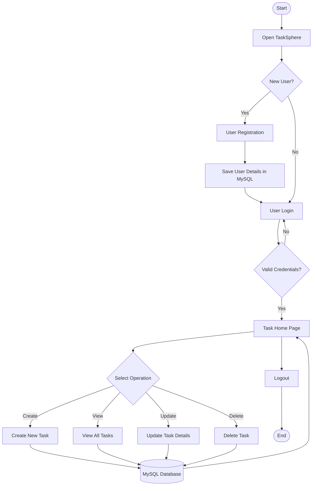

# TaskSphere – Task Management System

## 📌 Project Overview

TaskSphere is a Java-based web application developed to manage daily tasks efficiently. It provides a simple and user-friendly interface where users can register, log in, create tasks, view their tasks, update task details, and delete tasks.

The application follows the MVC architecture using Java Servlets and JSP, with MySQL as the backend database for storing user and task information.

## 🚀 Features

- **User Registration:** Allows new users to create an account.
- **User Login:** Provides authentication for registered users.
- **Create Task:** Users can add new tasks with task name, description, story points, and assigned user.
- **View Tasks:** Displays the available tasks.
- **Update Task:** Allows users to modify existing task details.
- **Delete Task:** Allows users to remove tasks.
- **Database Integration:** Stores user and task information in MySQL.

## 🛠️ Technologies Used

| Technology | Purpose |
|---|---|
| Java | Backend Programming |
| Jakarta Servlets | Request Handling and Controller Logic |
| JSP | Dynamic Web Pages |
| MySQL | Database Management |
| JDBC | Database Connectivity |
| HTML | Page Structure |
| CSS | Styling |
| Bootstrap | Responsive UI |
| Apache Tomcat 11.0.4 | Application Server |
| Eclipse IDE | Development Environment |
| Git & GitHub | Version Control |

## 🏗️ Project Architecture

The project follows the MVC (Model-View-Controller) architecture.

- **Model:** Handles application data and objects.
- **View:** JSP pages provide the user interface.
- **Controller:** Java Servlets handle incoming requests and application logic.
- **DAO (Data Access Object):** Manages database operations.

## 📂 Database Structure

The application uses MySQL with the following main tables:

**1. Users Table**
- user_id
- name
- email
- password

**2. Tasks Table**
- task_id
- task_name
- task_description
- story_points
- assigned_to

Database SQL scripts are available in the `database` folder.

## 🔄 Project Workflow



## ⚙️ Installation and Setup

1. Clone this repository:

   ```bash
   git clone https://github.com/ambikakrishna10/TaskSphere-Task-Management-System.git
   ```

2. Import the project into Eclipse IDE.

3. Create a MySQL database.

4. Execute the SQL script provided in the `database` folder.

5. Configure the database connection details in the project.

6. Configure Apache Tomcat 11.0.4 in Eclipse.

7. Run the project on the Tomcat server.

8. Open the application in your browser and register a new account.

## 🎯 Learning Outcomes

- Practical implementation of Java Servlets and JSP.
- Understanding MVC architecture.
- Database connectivity using JDBC.
- Performing CRUD operations using MySQL.
- Handling HTTP requests and responses.
- Developing dynamic web applications.
- Understanding DAO design patterns.

